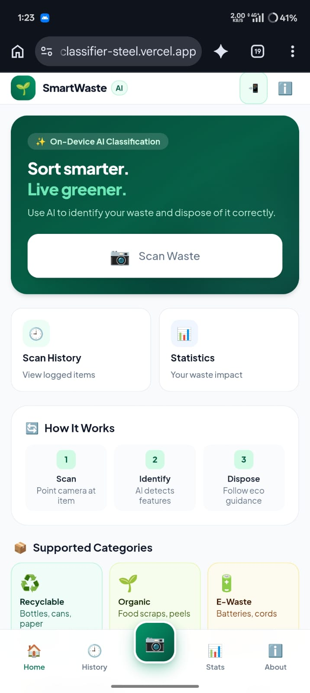
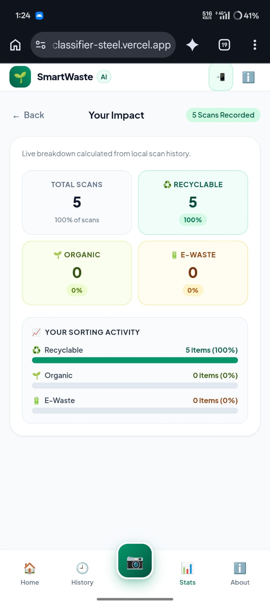
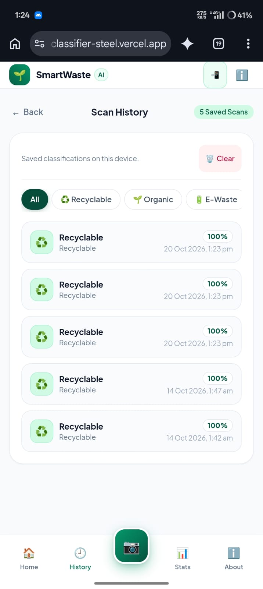
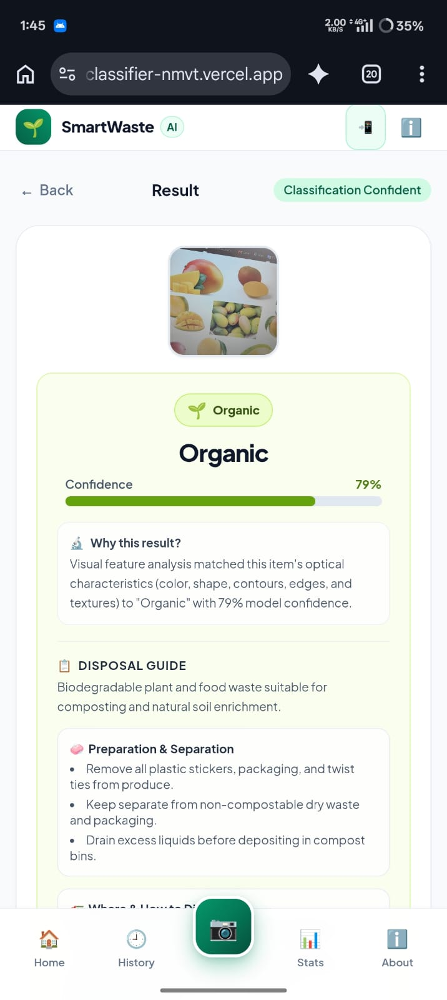
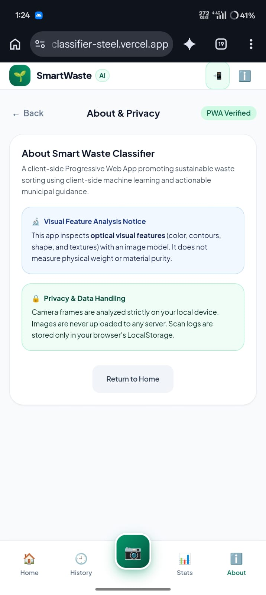

<div align="center">

# ♻️ Smart Waste Classifier

### AI-Powered Waste Classification & Disposal Guidance

<p>
  A mobile-first Progressive Web App that uses camera-based
  image classification to identify waste and provide disposal guidance.
</p>

<p>
  <a href="https://smart-waste-classifier-steel.vercel.app">
    
  </a>
  <a href="https://github.com/injmam089/smart-waste-classifier">
    
  </a>
</p>

<p>
  
  
  
  
  
</p>

<p>
  
  
  
</p>

</div>

---

## 🌱 Overview

**Smart Waste Classifier** is a camera-based, AI-assisted Progressive Web App designed to help users identify common waste categories and understand how the detected item should be handled.

The application uses a trained **Google Teachable Machine image-classification model** to classify visible waste into three supported categories:

- ♻️ **Recyclable**
- 🌱 **Organic**
- ⚡ **E-Waste**

After classification, the application evaluates the model confidence, displays the result, and provides category-specific disposal guidance.

The application also provides local scan history and statistics using browser storage, allowing the MVP to operate without a project-owned backend.

---

## 🚀 Live Application

<div align="center">

### 🌐 Try the Application

<a href="https://smart-waste-classifier-steel.vercel.app">
  
</a>

</div>

---

## 📸 Application Screenshots

Explore the application's primary screens.

### 🏠 Home Screen

<p align="center">
  
</p>

### 🤖 Classification Result

<p align="center">
  
</p>

### 🕘 Scan History

<p align="center">
  
</p>

### 📊 Statistics Dashboard

<p align="center">
  
</p>

### 🔐 About & Privacy

<p align="center">
  
</p>
### 🔐 About & Privacy


</div>

---

# ✨ Features

<table>
<tr>
<td width="50%">

## 📷 Camera Scanner

Capture waste directly using the device camera through browser camera APIs.

</td>

<td width="50%">

## 🤖 AI Classification

Uses a Google Teachable Machine image-classification model to analyze captured waste.

</td>
</tr>

<tr>
<td>

## 🎯 Confidence Validation

Predictions are checked against a configurable confidence threshold.

</td>

<td>

## 🗑️ Disposal Guidance

Provides category-specific guidance after an accepted classification.

</td>
</tr>

<tr>
<td>

## 🕘 Local Scan History

Stores accepted scan metadata locally in the browser.

</td>

<td>

## 📊 Statistics

Displays local sorting activity and category distribution.

</td>
</tr>

<tr>
<td>

## 📱 Progressive Web App

Includes a Web App Manifest and Service Worker for a PWA experience.

</td>

<td>

## 🔐 Privacy-Aware

Raw camera images are not stored as part of the application's scan-history model.

</td>
</tr>
</table>

---

# ♻️ Supported Waste Categories

The current model supports three primary categories.

| Category | Example Items | General Guidance |
|:---:|---|---|
| ♻️ **Recyclable** | Plastic bottles, paper, cardboard, metal cans | Clean where appropriate and use the suitable recycling stream |
| 🌱 **Organic** | Food scraps, leaves | Separate from other waste and use composting/organic collection where available |
| ⚡ **E-Waste** | Phones, batteries, cables, electronics | Keep separate and use authorized e-waste collection/recycling |

---

# 🧠 AI Classification

The application uses a **Google Teachable Machine image-classification model** trained for the supported waste categories.

The model receives visual input and returns prediction scores for the available classes.

The application then:

1. Reads the model predictions.
2. Identifies the highest-scoring supported category.
3. Checks the confidence score.
4. Accepts or rejects the result based on the configured threshold.
5. Displays the appropriate result and disposal guidance.

### Supported Classes

```text
Recyclable
Organic
E-Waste
```

---

## 🎯 Confidence Threshold

The default confidence threshold is:

```text
75%
```

The classifier uses:

```javascript
const CONFIDENCE_THRESHOLD = 0.75;
```

### Result Handling

| Model Confidence | Application Behaviour |
|:---:|---|
| **≥ 75%** | ✅ Classification can be accepted |
| **< 75%** | ⚠️ Result is treated as uncertain |

When confidence is below the configured threshold, the application encourages the user to improve the framing, lighting, or positioning of the waste item and rescan it.

> **Important:** The displayed confidence is the model's prediction score. It should not be interpreted as guaranteed identification accuracy.

---

# ⚠️ AI Limitations

The application performs **visual classification**.

It does not directly measure or guarantee:

- Physical weight
- Exact dimensions
- Material composition
- Chemical composition
- Physical properties that cannot reliably be determined from a camera image

Prediction quality can vary depending on:

- Lighting conditions
- Camera quality
- Object angle
- Object distance
- Background
- Visibility of the item
- Multiple objects in the frame
- Similar-looking objects
- Training data

For better results, users should place a single item clearly inside the camera view.

---

# 🗑️ Disposal Guidance

After an accepted classification, the application provides guidance based on the detected waste category.

## ♻️ Recyclable

Recommended handling includes:

- Clean the item where appropriate.
- Separate recyclable material.
- Use the appropriate recycling collection stream.

## 🌱 Organic

Recommended handling includes:

- Separate organic waste from other waste.
- Use composting where suitable.
- Follow available organic-waste collection procedures.

## ⚡ E-Waste

Recommended handling includes:

- Keep electronic waste separate.
- Do not mix it with ordinary household waste.
- Use authorized e-waste collection or recycling facilities where available.

---

# 🏗️ Architecture

Smart Waste Classifier follows a lightweight, client-side architecture.

The main application responsibilities are handled by the browser:

- Camera access
- Image capture
- AI model loading
- Image classification
- Confidence evaluation
- Waste-category mapping
- Disposal guidance
- Local history
- Statistics
- PWA functionality

The MVP does **not require a project-owned backend**.

---

# 🛠️ Technology Stack

<div align="center">

| Layer | Technology |
|:---|:---|
| 🎨 Frontend | HTML5 |
| 🎨 Styling | CSS3 |
| ⚙️ Application Logic | Vanilla JavaScript |
| 🤖 AI / ML | Google Teachable Machine |
| 🧠 Model Runtime | Teachable Machine Image API |
| 📷 Camera | Browser MediaDevices / Camera APIs |
| 💾 Local Data | Browser LocalStorage |
| 📱 PWA | Web App Manifest + Service Worker |
| 🔧 Version Control | Git |
| 💻 Repository | GitHub |
| ☁️ Deployment | Vercel |

</div>

---

# 📂 Project Structure

```text
smart-waste-classifier/
│
├── assets/
│   └── screenshots/
│
├── css/
│   └── style.css
│
├── js/
│   ├── app.js
│   ├── camera.js
│   ├── classifier.js
│   └── waste-data.js
│
├── model/
│   └── ...
│
├── .gitignore
│
├── index.html
├── manifest.json
├── service-worker.js
│
├── DEPLOYMENT.md
├── FINAL_AUDIT.md
├── PROJECT_AUDIT.md
├── README.md
├── SMART_WASTE_CLASSIFIER_ANTIGRAVITY_MASTER_PLAN.md
└── TEST_REPORT.md
```

---

# 🧩 Core Modules

## `app.js`

Responsible for the main application behaviour and coordination between different parts of the application.

Typical responsibilities include:

- Application initialization
- UI state management
- Navigation
- Scan workflow
- Result handling
- History/statistics integration

---

## `camera.js`

Responsible for browser camera functionality.

Responsibilities include:

- Requesting camera access
- Starting the camera stream
- Managing the camera preview
- Capturing frames
- Handling camera-related errors

---

## `classifier.js`

Responsible for AI model integration and classification.

Important configuration includes:

```javascript
const CONFIDENCE_THRESHOLD = 0.75;

const SUPPORTED_CATEGORIES = [
    'recyclable',
    'organic',
    'ewaste'
];
```

The default model is configured through a Google Teachable Machine model.

---

## `waste-data.js`

Contains the waste-category information used by the application.

This includes category-specific information such as:

- Category names
- Guidance
- Preparation information
- Separation instructions

---

# 💾 Local Data Storage

The MVP uses the browser's **LocalStorage** for scan history.

A scan record can contain:

```text
scanId
timestamp
category
predictedClass
confidence
guidanceKey
```

### Example Data Structure

```json
{
  "scanId": "scan-001",
  "timestamp": "2026-10-20T10:30:00Z",
  "category": "RECYCLABLE",
  "predictedClass": "plastic-bottle",
  "confidence": 0.91,
  "guidanceKey": "recyclable"
}
```

The exact runtime structure may vary according to the application's implementation.

---

# 🕘 Scan History

The History section allows users to review accepted scan results.

It provides:

- Saved scan records
- Timestamps
- Waste categories
- Confidence information
- Category filtering
- Reverse chronological display
- History clearing

The history is stored locally in the browser.

---

# 📊 Statistics

The Statistics section summarizes the user's locally stored scan activity.

It can display:

- Total scans
- Recyclable count
- Organic count
- E-Waste count
- Category percentages
- Sorting activity

Statistics are derived from the locally stored scan history.

---

# 🧹 Clear History

The application provides functionality to clear saved scan history.

The clear-history workflow is designed to prevent accidental deletion through confirmation before local records are removed.

---

# 📷 Camera Handling

The application uses browser camera APIs to provide the scanning experience.

The camera workflow includes:

1. Request camera permission.
2. Start the live preview.
3. Allow the user to position the waste item.
4. Capture the current frame.
5. Pass the visual input to the classifier.
6. Display the processed result.

The application uses the environment-facing camera where supported.

---

# 📱 Progressive Web App

Smart Waste Classifier includes PWA functionality through:

```text
manifest.json
service-worker.js
```

The PWA implementation provides:

- Application metadata
- Installable web-app behaviour where supported
- Service-worker registration
- Caching of supported application resources

### Important

PWA caching does **not** mean that the default remote AI model is guaranteed to work completely offline.

---

# 🔐 Privacy

Privacy is an important part of the MVP architecture.

The application is designed around local browser processing and local scan metadata.

### Camera Data

The browser camera is used to capture the visual input required for classification.

### Image Storage

Raw camera images are not stored as part of the application's scan-history data model.

### Scan History

Scan metadata is stored using browser LocalStorage.

### Backend

The MVP does not require a project-owned backend for its core functionality.

### Authentication

The core MVP does not require:

- User accounts
- Passwords
- Login systems

---

# 🔒 Security Considerations

The project follows a lightweight security approach suitable for its client-side MVP.

Important considerations include:

- Browser-controlled camera permissions
- HTTPS for production deployment
- No unnecessary personal-data collection
- Local storage of scan metadata
- No project-owned image-upload backend
- Controlled use of third-party AI/runtime dependencies
- Friendly error handling

Production deployment should use HTTPS so that browser camera APIs can operate under a secure context.

---

# 🌐 Browser Requirements

The application is intended for modern browsers supporting the required Web APIs.

The browser should support:

- JavaScript
- Camera / MediaDevices APIs
- LocalStorage
- Service Workers
- Web App Manifest support

Camera access requires an appropriate browser security context.

### Local Development

Recommended:

```text
http://localhost
```

or:

```text
http://127.0.0.1
```

### Production

Recommended:

```text
HTTPS
```

---

# 🚀 Getting Started

## 1. Clone the Repository

```bash
git clone https://github.com/injmam089/smart-waste-classifier.git
```

## 2. Open the Project

```bash
cd smart-waste-classifier
```

## 3. Start a Local Server

The project is a static web application, so it can be served using a simple local server.

---

## 🐍 Option 1 — Python

If Python is installed:

```bash
python -m http.server 8000
```

Then open:

```text
http://localhost:8000
```

---

## 🟦 Option 2 — VS Code Live Server

1. Open the project in VS Code.
2. Install the Live Server extension if needed.
3. Open `index.html`.
4. Start Live Server.
5. Open the generated local URL.

---

## 🟨 Option 3 — `serve`

If Node.js is installed:

```bash
npx serve .
```

Open the address shown in the terminal.

---

# 📷 Camera Testing on Mobile

When testing on a physical mobile device:

- Use an HTTPS deployment, or
- Use a secure HTTPS development tunnel.

A normal insecure network address may not provide the required camera permissions depending on the browser environment.

---

# ☁️ Deployment

The project can be deployed using static hosting platforms.

Supported deployment options include:

- Vercel
- Netlify
- GitHub Pages
- Other HTTPS static hosting providers

---

# ▲ Vercel Deployment

The project is currently deployed using Vercel.

A typical deployment workflow is:

1. Push the project to GitHub.
2. Open Vercel.
3. Import the GitHub repository.
4. Configure the project as a static web application.
5. Deploy.
6. Open the generated HTTPS URL.

The live application is available at:

**https://smart-waste-classifier-steel.vercel.app**

---

# 🧪 Testing

Testing focuses on the application's major functional areas.

| Area | What is Tested |
|:---|:---|
| 🚀 Launch | Application starts correctly |
| 🧭 Navigation | Main application sections work |
| 📷 Camera | Permission and live preview |
| 📸 Capture | Valid frame capture |
| 🤖 Model | AI model loading |
| 🧠 Prediction | Supported classifications |
| 🎯 Confidence | Threshold behaviour |
| ⚠️ Uncertainty | Low-confidence handling |
| 🗑️ Guidance | Correct disposal guidance |
| 🕘 History | Local persistence |
| 📊 Statistics | Correct category counts |
| 🧹 Clear History | Local data removal |
| 📱 Responsive UI | Mobile/tablet/desktop layouts |
| 📲 PWA | Manifest and service worker |
| ⚠️ Errors | Camera/model/storage failures |

---

# 🎯 Confidence Testing

The application should be tested with results on both sides of the default threshold.

### Accepted

```text
Confidence >= 0.75
```

Expected:

```text
Classification accepted
↓
Result displayed
↓
Guidance displayed
↓
Scan can be stored
```

### Uncertain

```text
Confidence < 0.75
```

Expected:

```text
Classification treated as uncertain
↓
User receives feedback
↓
User can rescan
```

---

# 🧪 History Testing

History functionality should verify that:

- Accepted scans are stored.
- Scan timestamps are available.
- Categories are stored correctly.
- Saved records remain after page reload.
- Category filtering works.
- Statistics reflect stored records.
- Clearing history removes local records after confirmation.

---

# 📱 Responsive Testing

The interface should be checked across:

### Mobile

- Camera
- Home
- Result
- History
- Statistics
- About

### Tablet

- Layout scaling
- Navigation
- Result presentation
- Camera controls

### Desktop

- Application layout
- Navigation
- Content spacing
- Statistics presentation

---

# ⚠️ Error Handling

The application accounts for several common failure conditions.

### 🚫 Camera Permission Denied

The application informs the user that camera access is unavailable and explains the required permission.

### 📷 Camera Unavailable

The application reports camera availability or compatibility problems.

### 🤖 Model Loading Failure

If the model cannot be loaded, the application should not present an invalid classification.

### 📸 Invalid Capture

The user can capture another frame if the current input cannot be processed.

### 🎯 Low Confidence

The result is treated as uncertain and the user is encouraged to rescan.

### 💡 Poor Lighting

The user can improve lighting and framing before trying again.

### 🗑️ Multiple Objects

The user should isolate a single item for better visual classification.

### 💾 Storage Failure

If LocalStorage is unavailable, the application can inform the user that scan history cannot be saved.

---

# 📋 Functional Requirements

The implementation covers the main MVP requirements.

| ID | Requirement | Application Area |
|:---:|:---|:---|
| FR-01 | Application launch | Home |
| FR-02 | Camera permission | Camera |
| FR-03 | Live camera preview | Camera |
| FR-04 | Capture waste frame | Camera |
| FR-05 | Load classification model | Classifier |
| FR-06 | Generate prediction | Classifier |
| FR-07 | Select supported category | Classifier |
| FR-08 | Apply confidence threshold | Classifier |
| FR-09 | Handle low confidence | Rescan workflow |
| FR-10 | Display result | Result screen |
| FR-11 | Display disposal guidance | Guidance |
| FR-12 | Store accepted scans | LocalStorage |
| FR-13 | Display statistics | Statistics |
| FR-14 | Clear history | History |
| FR-15 | Rescan | Camera workflow |
| FR-16 | PWA support | Manifest + Service Worker |
| FR-17 | Error handling | Application |
| FR-18 | No project-owned image upload | Client-side MVP |

---

# 🎨 User Experience

The interface follows a mobile-first design approach.

The main navigation provides access to:

```text
Home
History
Camera
Statistics
About
```

The primary user interaction is intentionally simple:

```text
Scan
→
Identify
→
Understand
→
Dispose
```

The application provides visual feedback for:

- Loading
- Processing
- Successful classification
- Low-confidence results
- Errors
- Camera permission
- Storage availability

---

# 🧱 Design Principles

## Simple

The scanning process should require minimal interaction.

## Responsive

The application adapts to mobile, tablet, and desktop screen sizes.

## Local-First

Scan metadata is maintained locally using browser storage.

## Privacy-Aware

The MVP avoids unnecessary image transmission and raw image storage.

## Modular

Camera, classification, waste information, and application logic are separated into dedicated modules.

## Explainable

The result screen provides the classification and associated disposal guidance rather than displaying only a category name.

---

# 📚 Project Documentation

The repository includes supporting project documentation.

| File | Description |
|:---|:---|
| `README.md` | Main project documentation |
| `DEPLOYMENT.md` | Deployment-related information |
| `PROJECT_AUDIT.md` | Project audit documentation |
| `FINAL_AUDIT.md` | Final audit information |
| `TEST_REPORT.md` | Testing documentation |
| `SMART_WASTE_CLASSIFIER_ANTIGRAVITY_MASTER_PLAN.md` | Development/project plan |

---

# 🔮 Future Scope

The current MVP can be extended with additional capabilities.

Potential future improvements include:

- More detailed waste categories
- Larger and more balanced training datasets
- Multilingual support
- Location-based recycling center information
- Optional cloud synchronization
- Optional user accounts
- Object detection and segmentation
- Improved model calibration
- Smart-bin / IoT integration
- Environmental impact analytics

> These items represent **future scope** and are not presented as current MVP functionality.

---

# 🎯 Project Objectives

The project is designed around the following objectives:

- Make waste identification easier for everyday users.
- Provide AI-assisted visual classification.
- Support basic waste segregation.
- Provide useful disposal guidance.
- Maintain local scan history.
- Provide basic sorting statistics.
- Demonstrate practical AI/ML integration in a web application.
- Provide an installable PWA experience.
- Keep the MVP lightweight and client-side.

---

# 📌 Current MVP Scope

The current implementation focuses on:

| Capability | Status |
|:---|:---:|
| Camera-based scanning | ✅ |
| AI image classification | ✅ |
| Recyclable category | ✅ |
| Organic category | ✅ |
| E-Waste category | ✅ |
| Confidence threshold | ✅ |
| Low-confidence handling | ✅ |
| Disposal guidance | ✅ |
| Local scan history | ✅ |
| Statistics | ✅ |
| Clear history | ✅ |
| Responsive UI | ✅ |
| PWA support | ✅ |
| Client-side MVP | ✅ |
| Project-owned backend | Not required |
| Raw image history storage | ❌ |
| Physical weight measurement | ❌ |
| Exact dimension measurement | ❌ |
| Material composition measurement | ❌ |

---

# ❌ What This Project Does Not Claim

To keep the application's scope clear, Smart Waste Classifier does not claim to:

- Guarantee perfect classification accuracy.
- Professionally certify waste material.
- Physically measure the weight of an item.
- Measure exact object dimensions.
- Determine exact chemical/material composition from an image.
- Replace authorized waste-management guidance.
- Guarantee that every type of waste can be correctly identified.

For hazardous, electronic, chemical, medical, or otherwise regulated materials, users should follow applicable local regulations and authorized disposal procedures.

---

# 📦 Development Requirements

For local development, you need:

- A modern web browser
- Git
- A local static web server
- A camera-enabled device for scanning
- Internet access for the default remote model configuration

Python can be used for a simple local server:

```bash
python -m http.server 8000
```

---

# 🔧 Configuration

The classifier contains configuration for the supported categories and confidence threshold.

Example:

```javascript
const CONFIDENCE_THRESHOLD = 0.75;

const SUPPORTED_CATEGORIES = [
    'recyclable',
    'organic',
    'ewaste'
];
```

The default model configuration points to the project's configured Google Teachable Machine model.

The classifier structure can also support configurable model paths where applicable.

---

# 🌍 Deployment Considerations

Before deploying to production:

- Use HTTPS.
- Verify camera permissions.
- Verify the model URL/configuration.
- Test the application on mobile.
- Verify LocalStorage behaviour.
- Verify PWA registration.
- Test the service worker.
- Test classification on representative samples.
- Test low-confidence behaviour.
- Test error states.

---

# 🧠 Model Quality Considerations

The quality of an image-classification model depends heavily on the training data.

Training images should ideally contain variation in:

- Lighting
- Camera angle
- Distance
- Object orientation
- Background
- Appearance
- Object examples

A larger and more balanced dataset can improve generalization, but model performance should still be evaluated through actual testing rather than assumed from the training process alone.

---

# 🔐 Data Handling Summary

| Data | Handling |
|:---|:---|
| Camera permission | Controlled by browser |
| Camera frame | Used for classification |
| Raw camera image | Not stored in scan history |
| Scan metadata | LocalStorage |
| Category | Local scan record |
| Confidence | Local scan record |
| Timestamp | Local scan record |
| User account | Not required for MVP |
| Project backend | Not required for MVP |

---

# 📈 Why a PWA?

Using a Progressive Web App provides several practical advantages for this project:

- Runs directly in a browser.
- Works across supported devices.
- No traditional app-store installation is required.
- Can provide an installable experience.
- Supports responsive layouts.
- Can use device capabilities such as the camera.
- Allows static deployment.

---

# 💡 Use Cases

Smart Waste Classifier can be used for:

### 🏠 Everyday Waste Segregation

Users can identify common household waste and review appropriate disposal guidance.

### 🎓 Educational Demonstrations

The project can demonstrate practical applications of AI image classification and browser-based machine learning.

### 🌱 Environmental Awareness

The application can encourage users to think about proper waste segregation.

### 🧪 AI/ML Demonstration

The project demonstrates how a trained image-classification model can be integrated into a real web application.

---

# 🏆 Project Highlights

<div align="center">

| ♻️ | 🤖 | 📱 | 🔐 |
|:---:|:---:|:---:|:---:|
| Waste Classification | AI Integration | PWA | Local-First |
| **3 Categories** | **75% Threshold** | **Responsive UI** | **Local History** |

</div>

---

# 📜 License

This project is licensed under the **MIT License**.

See the repository license information for the applicable terms.

---

# 👨‍💻 Project Information

<div align="center">

### ♻️ Smart Waste Classifier

**AI-Powered Waste Classification & Disposal Guidance**

Built using:

**HTML5 · CSS3 · JavaScript · Google Teachable Machine · PWA**

<br>

<a href="https://github.com/injmam089/smart-waste-classifier">
  
</a>

<a href="https://smart-waste-classifier-steel.vercel.app">
  
</a>

</div>

---

<div align="center">

### 🌱 Sort Smarter. Dispose Responsibly.

**Smart Waste Classifier — Turning AI into practical waste-segregation assistance.**

</div>
